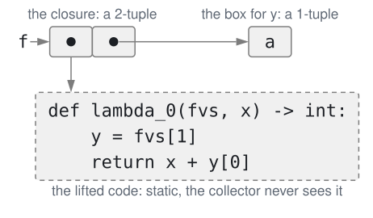
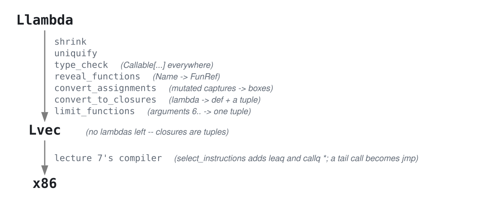

# Advanced Functions

Marcin Benke, MIM UW

Compiler Construction --- lecture 8

## Roadmap

### Today


- first class functions
- anonymous functions - lambda expressions
- nested functions, lexical scoping
- variable capture, closures
- capture by reference
- unlimited arguments
- efficient tail calls

## First-class functions

### Functions as values

So far we could do one thing with functions - call them.

But other entities (even complex ones) can be assigned, passed as arguments, received as results.

What if we want to write code like

```python
def choose(n, f, g):
  if n > 0:
    result = f
  else:
    result = g
  return result

x = input_int()
h = choose(x, decrease, increase)
print(h(x))
```

### Constructing functions

The previous example was a little boring and artificial. What about

```python
def compose(f, g):
  return lambda x: f(g(x))

def iterate(n, f):
  if n == 1:
    return f
  else:
    return compose(f, iterate(n-1, f))
```
Now we can have an unbounded number of functions, created dynamically!

### Function types

Function types are commonly written using mathematical notation - `f: t -> u`.

Python however has its own convention: `Callable[args, result]`, for example

```python
Callable[[int,int], int]
```

describes functions that take two ints and return an int.

### Lexical scoping

Lexical scoping means that a function body may refer to variables
whose binding site is outside of the function,
in an enclosing scope.

``` python
def f(x : int) -> Callable[[int], int]:
    y = 4
    return lambda z: x + y + z

g = f(5)
h = f(3)
print(g(11) + h(15))
```

Note: `lambda` is one example of lexical scoping, nested functions are another.

### x86 instructions needed

``` att
leaq f(%rip), %rcx  # Load Effective Address of f into %rcx
callq *%rcx         # call function at address in %rcx
```

so for example

``` python
x = input_int()
h = choose(x, decrease, increase)
print(h(x))
```

may become

```att
    callq input_int
    movq %rax, %rbx             # x in %rbx
    movq %rbx, %rdi
    leaq decrease(%rip), %rsi
    leaq increase(%rip), %rdx
    callq choose                # h in %rax
    movq %rbx, %rdi
    callq *%rax                 # h(x)
    movq %rax, %rdi
    callq print_int
```

In x86 AST, `lea` can be represented using the generic `Instr` node (but needs special handling in `patch_instructions`: its destination must be a register).

Indirect calls have their own node: `IndirectCallq`, with the call target included in the read set.

### Reveal functions

Note that an assignment `x = y` should produce different code when `y` is a function vs an `int`;<br/>
similarly for passing functions as arguments or returning them as results.

Hence we must always know (at least) if an identifier represents a function.

Common solutions to this involve annotating symbols with types or using a symbol table.

The book uses a separate node type: `FunRef(f,n)`, where `n` is function arity,<br/>
and a compiler pass: `reveal_functions` changing `Name(f)` to `FunRef(f, n)` where appropriate.

Note: `FunRef` nodes should be treated as complex by RCO - this way `select_arg` will not have to deal with them.

### FunRef in RCO

Where an atom is required, RCO binds the `FunRef` to a temporary:

```python
h = choose(x, decrease, increase)

# after RCO
tmp1 = FunRef(decrease, 1)
tmp2 = FunRef(increase, 1)
h = choose(x, tmp1, tmp2)
```

The assignment gives `leaq` its destination: `leaq decrease(%rip), tmp1`

Two cases to watch:

- **the function of a direct call** stays a `FunRef`, only the arguments
  become atoms: `add1(41)` is `callq add1`.<br/>
  With a temporary, every call would become `leaq` + `callq *`
- **`return f`** needs no temporary, so `FunRef` reaches instruction selection:
  `leaq f(%rip), %rax`

### Can we always tell?

Python allows code like

```python
def increase(x):
   return(x+1)

n = input_int()

if n > 0:
  f = increase
else:
  f = 0

if n > 0:
  print(f(41))
else:
  print(f)
```

Which leads to a question: can we always tell what is a function?

### Not Python

Despite the syntax, our language is **NOT** Python.

The typechecker rejects programs such as one above. Each identifier must have a unique type.

The book has a chapter on dynamic typing, but we are not going into that now.

Static typing makes life much easier.


## More than six arguments

### Parameter passing

```
rdi  rsi  rdx  rcx  r8  r9
```

in that order; the result in `%rax`.


What if there are more than six arguments?

- usually they go on the stack, above the return address
- in 32-bit mode all arguments are usually passed on the stack
- The EoC book uses another solution: tuples

### Parameters on the stack: the callee

```python
def f(a1, a2, a3, a4, a5, a6, a7):
   print(a7-a5)

f(1,2,3,4,5,6,7)
```

with parameters on the stack, may translate to (abbreviated)

```att
f:
    pushq %rbp
    movq %rsp, %rbp
    movq 16(%rbp), %rdi   # 8(%rbp) holds return addr
    subq %r8, %rdi        # a7-a5
    callq print_int
    popq %rbp
    retq
```

### Parameters on the stack: the call site

```att
main:
   pushq %rbp
   movq $1, %rdi
   ...
   movq $6, %r9
   subq $8, %rsp         # make sure stack is aligned at call
   pushq $7              # now the Q in pushq is important!
   callq f
   addq $16, %rsp        # clean up arg and padding
   popq %rbp
   retq
```

- `%rsp` must be a multiple of 16 at the `callq`; an odd number of
  pushed arguments needs 8 bytes of padding first
- arguments are pushed last-first, so the 7th ends up next to the return address
- the caller pops them afterwards --- it is the one that knows how many it pushed

### Limit functions

The EoC book uses another solution: if a function has more than 6
arguments, the first five are passed as usual and the rest as a tuple

So our example

```python
def f(a1, a2, a3, a4, a5, a6, a7):
   print(a7-a5)

f(1,2,3,4,5,6,7)
```

gets translated to

```python
def f(a1, a2, a3, a4, a5, rest):
   print(rest[1]-a5)

f(1,2,3,4,5, (6,7) )
```

That is the role of the `limit_functions` pass. Why a tuple and not the
stack? Because of tail calls --- see below.

### Compiler extension: more than six arguments

Either (but not both) of these methods can be implemented for extra credit.

## Efficient tail calls

### Tail calls

A *tail call* is a call that is the last action in a function body.

For example, the recursive call in `tail_sum`:

```python
def tail_sum(n : int, r : int) -> int:
    if n == 0:
        return r
    else:
        return tail_sum(n - 1, n + r)
```

With some care, tail calls can be turned into jumps; currently the `else` block becomes

```att
block.2:  # n: %rdi, r: %rsi
    addq %rdi, %rsi
    subq $1, %rdi
    callq tail_sum
    jmp tail_sum_conclusion
tail_sum_conclusion:
    popq %rbp
    retq
```

### The call becomes a jump

Instead, we can do:

```att
block.2:  # n: %rdi, r: %rsi
    addq %rdi, %rsi
    subq $1, %rdi
    popq %rbp
    jmp tail_sum
```

### Tail calls vs tail recursion

You may have heard about "tail recursion", we talk about "tail calls". What's the difference?

Our approach works also for tail calls that are not directly recursive, e.g.

```python
def even(n: int) -> int:
   ...
   return odd(n-1)
```

```att
   ...
   subq $1, %rdi
   popq %rbp
   jmp odd
```

### Direct recursion: a tight loop

For direct recursion, we could do even better:

```att
tail_sum_start:
    cmpq $0, %rdi
    je block.1
    jmp block.2

block.2:  # n: %rdi, r: %rsi
    addq %rdi, %rsi
    subq $1, %rdi
    cmpq $0, %rdi
    je block.1
    jmp block.2
```

turning recursion into a tight loop.

The original approach is also a loop but less efficient.

### Why a tuple, not the stack?

This is where `limit_functions` pays off:

- arguments 7.. on the stack live in the *caller's* frame ---
  the very frame a tail call pops before its `jmp`
- building them in the callee's frame instead does not help:
  the two frames overlap, so copying an argument in
  may overwrite one not yet copied
- with at most six arguments, all in registers, `popq %rbp; jmp f` is always valid;
  the 6th may be a pointer to a heap tuple, which outlives every frame

So it is tail calls, not the argument count, that make `limit_functions` pass the overflow in a tuple rather than on the stack.


## Anonymous functions

### Lambda

Sometimes we do not need to name a function, e.g. instead of
```python
choose(1, decrease, increase)
```
we can write
```python
choose(1, lambda x: x-1, lambda x: x+1)
```

In practice, the compiler needs to generate unique names for the lambdas.


### Closed and open expressions

We say that an expression like `lambda x: x-1` is *closed* --- it contains no *free variables*.

Variable `x` is *bound* in `lambda x: x-1`

Variable `y` is *free* in `lambda x: x+y`; the expression is *open*.

Compiling open functions is a challenge; consider:

```python
def f(x : int) -> Callable[[int], int]:
    y = g(7)
    return lambda z: x + y + z
```
In the returned lambda-expression:

 - `z` is bound (it is an argument)
 - `x`, `y` are free

Inside `f`, the argument `x` may have lived in the frame of `f` and `y` probably in a register.

When we return from `f`, both are most likely gone, so how can we execute the lambda?

### Functions need closure

Working with open functions directly is not realistic; they need closures.

A closure is a function together with a way of accessing its free variables.

- One way to close is to pass all necessary nonlocal data as parameters;<br/>
    this solution is sometimes used in functional languages
  (where data is immutable anyway).
- Another way is to pass a record containing values or addresses of nonlocal data used.


### Mutability and lexically scoped functions

Consider the following example in C++:

```c++
auto f(int a) {
  int x = a;
  return [&x](int y) -> int{ x += 1; return x + y; };
}
int main() {
  auto g = f(2);          // x = 2
  cout << g(100) << endl; // x = 3; x+y = 103
  cout << g(100) << endl; // x = 4; x+y = 104
  return 0;
}
```

Running this program gives unexpected results:
```
$ ./lam1
202
202
```

WTF?

### Dangling references: UB strikes again

C++ does not fully support functions as results
([cppreference.com](https://en.cppreference.com/w/cpp/language/lambda)):

>   If a non-reference entity is captured by reference,
>   and the function call operator is invoked
>   after the entity's lifetime has ended, **undefined behavior** occurs.

The C++ closures do not extend the lifetimes of objects captured by reference.

We are going to do better:
 copy captured values into a closure on the heap, and box those that are assigned to.

### What about Python?

The C++ example does not translate directly: in Python the lambda body is an expression.

Python has an assignment expression `x := e` but our language does not.

However, consider a situation where a captured variable is modified after the definition:

```python
def f(a: int) -> Callable[[int], int]:
  g: Callable[[int], int] = lambda x: x + a
  a = a + 1
  return g
```

The closure `g` must see the modified `a`.

### Python captures variables, not values

Try this in CPython:

```python
fs = [lambda: i for i in range(3)]
print([f() for f in fs])           # [2, 2, 2] -- not [0, 1, 2]
```

All three lambdas share one `i`, and read it only when called:

```python
>>> fs[0].__closure__
(<cell at 0x7c1abd903df0: int object at 0xb370c8>,)
>>> fs[0].__closure__[0] is fs[2].__closure__[0]
True
```

A *cell* is a box on the heap. CPython boxes every captured variable;
we will box only those that are assigned to --- and our boxes are 1-tuples.


### Unique variable names

With the addition of lambda we have a complication to deal with: name shadowing.

Consider the following program with a function:

```python
def f(x:int, y:int) -> Callable[[int], int]:
    g : Callable[[int],int] = (lambda x: x + y)
    h : Callable[[int],int] = (lambda y: x + y)
    x = input_int()
    return g

print(f(0, 10)(32))
```

- x is an argument of f but also of the first lambda;
- y is an argument of f but also of the second lambda;

This is a problem if we rely on identifying variables by name.

### uniquify

A simple solution is to systematically rename variables so that they have unique names.

```python
def f(x0:int, y1:int) -> Callable[[int], int]:
    g2 : Callable[[int],int] = (lambda x3: x3 + y1)
    h4 : Callable[[int],int] = (lambda y5: x0 + y5)
    x0 = input_int()
    return g2

print(f(0, 10)(32))
```

In the book this pass is called `uniquify`.

### Assignment conversion

Let us look again at an example with a mutable nonlocal variable:
```
def f(a: int) -> Callable[[int], int]:
  y = a
  h: Callable[[int], int] = lambda x: x + y
  y = y + 1
  return h
```

The (reference to) nonlocal variable `y` must be placed in the closure.

We must make sure that `y = y + 1` modifies the same `y` that `h` accesses.

### Boxing

`y` needs to be *boxed* - placed in a box on the heap. A box can be just a 1-tuple.

Boxing `y` involves three elements:

1. initialize `y` to a 1-tuple
1. replace reads from `y` with tuple reads
1. replace writes to `y` with tuple writes

```python
def f(a: int) -> Callable[[int], int]:
    y = (uninitialized,)        # a 1-tuple
    y[0] = a
    h: Callable[[int], int] = lambda x: x + y[0]
    y[0] = y[0] + 1
    return h
```

Note: boxing writes through the tuple --- it needs lecture 7's *mutable*
tuples. To run this in CPython, import `Callable`, define `uninitialized`
and use a list: `y = [uninitialized]`.


## Closure conversion

### convert_to_closures

Compilation of local functions into toplevel ones
is accomplished in the pass `convert_to_closures` that comes after
`reveal_functions` and before `limit_functions`.

We transform a lambda
expression into an **expression that creates a closure**,
that is, a tuple where

- first element is a function pointer
- the rest of the elements are the values of the free variables of the lambda.

In the sequel,
*fvs* is the list of free variables of the lambda;
*name* is a unique symbol generated to identify the lambda.

```
Lambda([x1, …, xn], body)
    ⇒  Closure(n, [FunRef(name, n), fvs1, …, fvsm])
```

`n`: the arity the program sees, without the closure parameter.

### Closure conversion example

Recall the output of assignment conversion:

```python
def f(a: int) -> Callable[[int], int]:
    y = (uninitialized,)        # a 1-tuple
    y[0] = a
    h: Callable[[int], int] = lambda x: x + y[0]
    y[0] = y[0] + 1
    return h
```
gets translated into

``` python
def lambda_0(fvs, x) -> int:
    y = fvs[1]          # element 0 is the function reference
    return x + y[0]

def f(fvs, a:int) -> Callable[[int], int]:  # fvs unused: see below
    boxed_y = (uninitialized,)  # a 1-tuple
    boxed_y[0] = a
    h = closure{1}({lambda_0}, boxed_y)   # renders a Closure node
    boxed_y[0] = boxed_y[0] + 1
    return h
```

### A closure in memory



Both tuples live on the heap, built by `expose_allocation` and collected
like any other --- lecture 7 already paid for all of this.


### Converting calls

In our example

```python
def f(a:int) -> Callable[[int], int]:
    ...

g = f(10)
print(g(9))
```

If f returns a closure (which is then assigned to g) then we must transform the call to g:

```python
g = f(10)          # g is a closure: ({lambda_0}, boxed_y)
print(g[0](g, 9))
```

But how do we know which calls to transform? How do we know to transform the call to `g` but not to `f`?

### Convert everyone

A simple solution is to transform every call:

```
Call(e, [e1 , … , en ])  ⇒  Begin([Assign([tmp], e′ )],
                            Call(Subscript(Name(tmp), 0), [tmp, e1' , … , en' ]))
```

and every function reference into closure:

```
FunRef(f , n)            ⇒  Closure(n, [FunRef(f, n)])
```

### Convert everyone, applied

Our example

```python
g = f(10)          # g is a closure: ({lambda_0}, boxed_y)
print(g[0](g, 9))
```

is transformed to

```python
g =  (begin: clos_1 = closure{1}({f},)   # no free variables
             clos_1[0](clos_1, 10) )
print(begin: clos_2 = g                  # already a closure
             clos_2[0](clos_2, 9) )
```

where `begin: stmts expr` is a rendering of the `Begin` AST node, introduced when talking about conditionals.

Actually if you look closer, not everyone: `print` is special.

### What converting everyone costs

Our `tail_sum`, closure-converted:

```python
def tail_sum(fvs, n: int, r: int) -> int:
    if n == 0:
        return r
    else:
        return (begin: clos = closure{2}({tail_sum},)
                       clos[0](clos, n - 1, n + r))
```

Every iteration now **allocates** a closure on the heap and makes an
**indirect** call (or `jmp *`).

Before closure conversion, the same loop was `jmp block.2` --- no
allocation, no indirection.

### Closure optimisation

This looks bananas, can't we just recognise calls of the form `Call(FunRef(_), _)` ?

Consider the following example:

```python
def add1(x : int) -> int:
    return x + 1

y = input_int()
g : Callable[[int], int] = lambda x: x - y
f = add1 if input_int() == 0 else g
print(f(41))
print(add1(41))
```

Here `f(41)` needs to be compiled into a closure application

Hence the definition of `add1` needs to be transformed to accept a closure.

Therefore also `add1(41)` needs to be transformed.

### Escaping functions

If a global function name is used in any way other than as the operator in a direct
call, then we say that the function escapes.

If a global function does not escape,
then we do not need to perform closure conversion on the function.

### Escaping functions: which ones?

```python
def add1(x: int) -> int:
    return x + 1

def sq(x: int) -> int:
    return x * x

def twice(f: Callable[[int], int], x: int) -> int:
    return f(f(x))

def inc(x: int) -> int:
    g: Callable[[int], int] = lambda y: add1(y)
    return g(x)

print(add1(41))          # 42
print(twice(sq, 3))      # 81
print(inc(41))           # 42
```
Which functions escape?

### Escaping functions: which ones?

```python
def add1(x: int) -> int:
    return x + 1

def sq(x: int) -> int:
    return x * x

def twice(f: Callable[[int], int], x: int) -> int:
    return f(f(x))

def inc(x: int) -> int:
    g: Callable[[int], int] = lambda y: add1(y)
    return g(x)

print(add1(41))          # 42
print(twice(sq, 3))      # 81
print(inc(41))           # 42
```

Only `sq` escapes --- it is passed as a value. `add1` is only ever
called, even inside the lambda; `twice` and `inc` are only called.

### Escaping functions: what changes

Only `sq` is closure-converted:

```python
def sq(fvs, x: int) -> int:   # fvs unused
    return x * x

def twice(f, x: int) -> int:  # f: always a closure
    return f[0](f, f[0](f, x))

print(add1(41))               # still callq add1
print(twice(closure{1}({sq},), 3))
```

A function that does not escape keeps its parameters as they were
--- no `fvs`. The lambda in `inc` is still a closure, but the call to
`add1` inside it stays direct.

### Known calls

`inc` after closure conversion:

```python
def inc(x: int) -> int:
    g = closure{1}({lambda_0},)    # g holds a closure of lambda_0...
    return (begin: clos = g        # ...so does clos, a copy of g...
                   clos[0](clos, x))   # ...so this call is known
```

can call `lambda_0` directly --- still passing the closure as `fvs`:

```python
    return (begin: clos = g
                   lambda_0(clos, x))  # callq lambda_0, not callq *
```

After closure conversion, map each variable assigned a closure to
its function, **following copies** like `clos = g`; a call through
that variable becomes a direct call.
(Only while the variable is not reassigned.)

In general, *which* lambda reaches a call is control-flow analysis
--- a research topic of its own.

### Compiler extension: escape analysis

* Implement detecting which global functions
escape.
* Then implement an improved version of closure conversion<br/>
that does not apply closure conversion to global functions that do not escape<br/>
but instead compiles them as regular functions.

### The pipeline



Five new passes, all before `expose_allocation`.

What they leave is an
`Lvec` program --- closures are tuples, boxes are tuples, the overflow
arguments are a tuple <br/> --- so lecture 7's compiler takes it from there.

## Wrapping up

### Summary

- **A function value is a code address**: `leaq f(%rip)` makes one,
  `callq *` calls it.
- **We must know statically what is a function** --- `reveal_functions`,
  and a type checker that rejects the rest.
- **A tail call pops its frame and jumps**: the return address
  already on the stack serves both.
- **At most six arguments, the rest in one tuple** --- that is what
  makes every tail call a jump.
- **A closure is a tuple**: a code pointer and the free variables.
  Every `lambda` becomes a top-level `def`.
- **Captured variables that are assigned to are boxed** --- a shared
  1-tuple.
- **Everything new runs before `expose_allocation`**; the back end
  learns only `leaq`, `callq *` and `jmp`.

Next time: optimisations --- SSA form first.

## Questions?

### Lab tasks --- all extensions

None of this is obligatory. Points as in the extensions list:

| | extension | needs |
|---|---|---|
| **1** | first-class functions (4p) | nothing new; rejecting ill-typed programs: type checker from tuples part 2 |
| **2** | efficient tail calls (3p) | nothing; with 1, also `jmp *` |
| **3** | more than six arguments (2p / 3p) | tuples part 1, or the stack |
| **4** | lexically scoped functions (6p) | 1, tuples part 1; boxing: part 3 |
| **5** | closure optimisation (3p) | 4 |

Each line needs at most the ones above it, so top to bottom is a safe order.

### Extensions 1--3: values, jumps, arguments

- **1** `reveal_functions`; `FunRef` complex in RCO; `leaq` (its
  destination a register --- `patch_instructions`); `IndirectCallq`,
  whose target is *read* --- liveness must say so.
  Test: `choose`, and a function returned from a function.
- **2** `explicate_tail` marks a call in `return` position; the
  conclusion goes *before* the `jmp`. So the target of a `jmp *` must
  be in `%rax` (`patch_instructions`): the conclusion destroys the
  frame and callee-saved registers, and arguments occupy the rest.
  Test: `tail_sum(1000000, 0)` must not crash.
- **3** `limit_functions`, at definitions and at calls alike.
  Stack arguments and tail calls do not mix: a tail call to a
  function with more than six parameters stays a `callq`.

### Extensions 4 and 5: closures

- **4** `uniquify`, then the free variables of a `lambda`, then
  `convert_to_closures` --- first **rejecting** a program that
  assigns to a captured variable. `convert_assignments` lifts that
  restriction; it needs mutable tuples.
- **4, with the collector**: a `Callable` value is now a pointer to a
  closure --- mask bit 1, root stack --- but element 0 *of* a closure
  is a code address, so its mask bit must be 0.
- **5** escape analysis: which `FunRef`s appear other than as the
  function of a call? Test: `add1` from "Closure optimisation".
  Then `optimize_known_calls`, after closure conversion.
  Test: `inc` from "Known calls".

## Extra material

### What we did not do

| omitted | consequence |
|---|---|
| dynamic typing (EoC ch. 10) | "can we always tell?" --- we answer by rejecting |
| sharing between closures | each closure copies its free variables; boxes are the only sharing |

### Further reading

- EoC ch. 8 (functions, tail calls, `limit_functions`) and ch. 9
  (lexically scoped functions) --- this lecture, in full.
- Landin (1964), *The Mechanical Evaluation of Expressions* --- where
  the closure comes from.
- Steele (1977), *Debunking the "Expensive Procedure Call" Myth* ---
  a tail call is a jump.
- Clinger (1998), *Proper Tail Recursion and Space Efficiency* ---
  what "efficient tail calls" has to guarantee, made precise.
- Shao, Appel (1994), *Space-Efficient Closure Representations* ---
  flat closures like ours, linked ones, and the trade-off.
- Keep, Hearn, Dybvig (2012), *Optimizing Closures in O(0) Time* ---
  where to go after escape analysis and known calls.
- PEP 227, *Statically Nested Scopes* --- how Python got cells.
